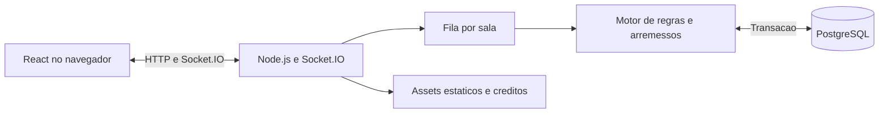
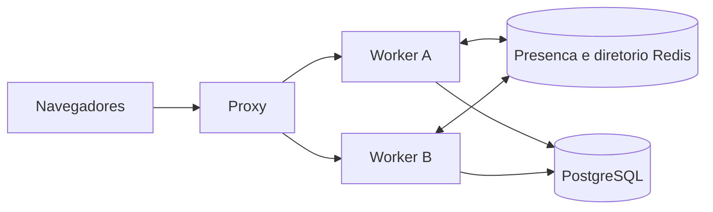

# Arquitetura do servidor de Dungeon Fighter web

A proposta é um monólito modular em TypeScript: cliente React com Vite, servidor Node.js 22 com Socket.IO e PostgreSQL como fonte durável das partidas. Cada sala tem um executor que ordena comandos e aplica as regras. A memória acelera o jogo; o banco permite retomá-lo. Redis entra quando houver várias instâncias, para presença, roteamento e comunicação entre processos.

Este documento define o contrato da implementação inicial. O README e os testes registram o que efetivamente funciona. Capacidade, restauração em produção e execução com várias instâncias não são resultados já medidos; não houve publicação nesta etapa.

## Estado da implementação

A implementação e os testes de integração verificaram fila por sala, autenticação por hash de credencial, filtragem de snapshots por participante, deduplicação por ator e comando, adaptador de arquivo com bloqueio de escritor e adaptador PostgreSQL com transação e bloqueio da linha da sala. Foram executados testes com dois clientes Socket.IO, PostgreSQL descartável e retomada após reiniciar o contêiner de produção. Os registros de validação ficam em docs/VALIDATION.md.

A retomada usa o snapshot durável mais recente. O histórico de comandos e eventos fornece metadados de diagnóstico e os resultados canônicos registrados, mas não é uma implementação completa de event sourcing: reconstruir qualquer revisão antiga exclusivamente por replay de eventos fica para uma evolução posterior. As mudanças de estado e o histórico confirmado precisam continuar atômicos.

Redis, múltiplos workers, transferência de propriedade com fencing, expiração automática das salas e restauração de backup são arquitetura futura, não funcionalidades comprovadas desta versão. O simulador inicial também é uma aproximação digital de arremesso; a validação física e de balanceamento é uma etapa distinta da persistência correta do resultado.

## Topologia inicial

O mesmo serviço pode entregar o cliente compilado e os assets selecionados. Uma origem única simplifica autenticação e proxy. O navegador transmite intenção — escolher dado, lançar ou usar item — e recebe estado e resultados. Ele não escolhe dano, face final, vida ou sucesso de uma restrição.

| Módulo | Responsabilidade |
| --- | --- |
| Transporte | Validar mensagem, autenticar conexão, limitar tamanho e frequência, responder aceite ou erro. |
| Serviço de sala | Resolver participante, assento, revisão, fila, retomada e visibilidade. |
| Motor de regras | Aplicar comando a um estado e produzir estado e eventos, sem sockets ou banco. |
| Simulador | Calcular trajetória a partir de parâmetros validados e aleatoriedade do servidor. |
| Repositório | Gravar comando, eventos e snapshot atomicamente; carregar após falha. |
| Conteúdo | Versionar heróis, encontros, equipamento, desafios e assets com procedência. |

O jogo por turnos permite transações curtas por ação. Animação não exige gravar cada quadro no banco. Não são necessários microserviços, um banco por sala ou fila externa no primeiro lançamento.

## Persistência

PostgreSQL guarda snapshot e histórico de comandos e eventos. A evolução do contrato prevê que as versões do motor, conteúdo e simulador acompanhem a sala para impedir que uma atualização altere regras de uma partida em andamento. A versão inicial registra a versão de conteúdo; compatibilidade entre atualizações de motor ainda precisa de política explícita.

| Tabela | Campos e invariantes |
| --- | --- |
| `rooms` | `code`, `revision`, `record` JSONB com estado e recibos de comandos, `updated_at`. O estado registra a versão de conteúdo. |
| `room_commands` | Sala, ator, ID de comando, hash da requisição e revisão resultante. Chave única por sala, ator e comando. |
| `room_events` | Sala, revisão crescente, tipo, ator, payload de diagnóstico/resultado e comando causador. Revisão única por sala. |

Participantes e hashes de credenciais podem começar no snapshot privado. Nunca enviar esse documento inteiro ao navegador. Separar tabelas de sessões e contas quando identidade permanente ou consultas justificarem a mudança.

Proposta de retenção inicial: expirar salas inativas após sete dias, com prazo configurável. Chat não precisa ser retido permanentemente. A limpeza remove registros associados de maneira consistente; backups têm política própria a definir antes da publicação pública.

### Desenvolvimento sem banco

Um adaptador JSON permite rodar localmente sem instalar PostgreSQL. Deve ter apenas um processo escritor e gravar comandos e snapshot no mesmo documento por troca atômica de arquivo. É um modo de desenvolvimento: não oferece concorrência entre processos nem substitui backup ou banco transacional.

Produção usa PostgreSQL e falha claramente se a configuração ou a conexão estiver inválida. Não troca silenciosamente para memória ou arquivo, aparentando persistência de produção.

## Caminho de um comando

Todos os comandos que alteram a sala usam a mesma fila: entrada, escolha de herói, pronto, início, compra, lançamento e habilidade. Serializar somente arremessos deixa outros recursos sujeitos a disputa.

1. Autenticar a conexão e identificar o participante no servidor. Um `heroId` enviado não substitui essa identidade.
2. Validar mensagem e limites; entrar na fila da sala.
3. Abrir transação numa conexão reservada do pool e carregar a linha da sala com bloqueio de escrita.
4. Consultar idempotência. Um comando confirmado com o mesmo ator e conteúdo retorna um recibo de repetição e a referência ao resultado já confirmado; mesmo ID com outra intenção é conflito. A sincronização da mesa pode acompanhar o recibo com o snapshot atual, sem voltar o cliente à revisão antiga.
5. Comparar `expectedRevision` à revisão carregada. Comando antigo ainda não confirmado recebe estado atualizado para nova decisão do cliente.
6. Aplicar regras; gravar eventos, comando e snapshot com nova revisão na mesma transação.
7. Confirmar o commit. Só depois enviar aceite e transmitir as projeções aos clientes.

Deduplicação vem antes de rejeitar revisão antiga: quem perdeu o ACK de um lançamento deve poder repetir a mensagem original e receber o resultado já gravado. O contrato é efeito idempotente de comandos identificados, não entrega exatamente uma vez pela rede.

No PostgreSQL, `SELECT ... FOR UPDATE` permite bloquear a linha durante a atualização. Isso não substitui validar revisão e identidade; serializa escritores que usam o mesmo contrato. [Bloqueios de linha](https://www.postgresql.org/docs/current/explicit-locking.html#LOCKING-ROWS).

As consultas de uma transação node-postgres devem usar o mesmo `client` retirado do pool do `BEGIN` até `COMMIT` ou `ROLLBACK`. Chamadas independentes de `pool.query` não preservam esse vínculo. [Transações em node-postgres](https://node-postgres.com/features/transactions).

### Queda durante o lançamento

O servidor calcula e grava o resultado antes de apresentá-lo. O cliente reproduz a trajetória recebida; o tempo da animação não é o tempo da transação. Antes do commit, o comando ainda não foi aceito. Depois, o resultado gravado prevalece, mesmo que ninguém tenha assistido à animação.

Se a conexão com o banco cair durante o commit e o resultado ficar incerto, consultar o registro do mesmo comando antes de tentar aplicá-lo novamente. Um lançamento já aceito não ganha outro sorteio. A decisão de manter ou relançar é um subestado persistido. No protótipo, o poder do dado branco é pré-selecionado antes do arremesso; esse controle pode evoluir para uma escolha posterior.

## Reconexão e privacidade

Convite e credencial de retomada têm finalidades distintas. A credencial possui alta entropia, trafega por conexão criptografada e fica no servidor apenas como hash; não aparece na URL de convite ou em logs.

O bootstrap também deve suportar ACK perdido: gerar e guardar credencial no cliente antes de criar ou entrar, ou implementar outro mecanismo seguro de repetição que devolva o mesmo assento. Token existente apenas no primeiro ACK pode tornar o assento inacessível após queda da rede.

O servidor deriva permissões da credencial. Rejeita ações de outro herói e decisões fora da fase. Dois navegadores com a mesma credencial seguem política explícita de substituição de conexão; isso não cria outro participante.

| Projeção | Conteúdo |
| --- | --- |
| Pública | Heróis, vida, ouro, dados, fase e encontro revelado. |
| Privada do líder | Duas salas candidatas enquanto a escolha está aberta. |
| Somente servidor | Baralhos ordenados, sorteios futuros, hashes de credenciais e persistência interna. |

Quando o papel de espectador for implementado, receberá somente a projeção pública. Para salas pequenas, um snapshot filtrado após cada comando simplifica a recuperação. Atualizações incrementais podem vir quando houver evidência de necessidade.

Socket.IO mantém a ordem de mensagens entregues, mas a entrega padrão é no máximo uma vez. Confirmações e tentativas não substituem IDs e registros duráveis. [Garantias de entrega](https://socket.io/docs/v4/delivery-guarantees/).

A recuperação automática de conexão é uma otimização para interrupções temporárias e pode falhar. Sempre oferecer retomada com credencial e snapshot/revisão, inclusive após reinício, e revalidar permissões. [Recuperação de conexão](https://socket.io/docs/v4/connection-state-recovery/).

## Quando usar Redis

Uma instância não precisa de Redis para guardar a sala: tem memória para acesso rápido e PostgreSQL para durabilidade. Um terceiro sistema acrescentaria configuração e pontos de falha sem necessidade demonstrada.

Com vários processos, Redis pode manter presença com TTL, diretório de sala para worker, limites distribuídos e avisos entre servidores. Esses dados são efêmeros e reconstruíveis. O estado confirmado continua no PostgreSQL.

O Redis adapter de Socket.IO encaminha mensagens, mas não escolhe quem executa as regras. O adapter Pub/Sub não suporta recuperação automática de conexão. [Redis adapter](https://socket.io/docs/v4/redis-adapter/).

Pub/Sub não é log durável: uma publicação perdida durante desconexão não será retransmitida. Redis Streams persiste mensagens e é uma alternativa de transporte, mas não elimina deduplicação ou propriedade da sala. [Semântica de Pub/Sub](https://redis.io/docs/latest/develop/pubsub/#delivery-semantics).

### Evolução para várias instâncias

Essa etapa exige propriedade com geração crescente ou fencing token, validado na escrita durável. Worker que perdeu a propriedade deixa de aceitar comandos; só expirar uma chave não impede processo atrasado de continuar escrevendo. O novo proprietário carrega a revisão durável antes de retomar.

Mantendo HTTP long-polling, o balanceador precisa de afinidade por sessão. O Redis adapter sozinho não resolve isso. WebSocket exclusivo dispensa afinidade do transporte enquanto a conexão existe, mas não resolve roteamento nem autoridade da sala. [Múltiplos nós](https://socket.io/docs/v4/using-multiple-nodes/).

## Operação

A publicação inicial usa um contêiner do jogo e PostgreSQL em rede privada, com volumes persistentes, saúde e backup. TLS termina no proxy. Banco e eventual Redis não têm portas públicas desnecessárias. Segredos de conexão ficam no ambiente, nunca no repositório ou no cliente.

Registrar sala, comando, revisão e duração, sem tokens. Monitorar conexões, filas, latência de commit, falhas de persistência e memória. Definir limites de salas e participantes antes de expor o serviço público.

A validação de publicação inclui dois navegadores, repetição de comando, retomada após reinício, sigilo das salas candidatas e restauração de backup. Teste do adaptador local não comprova PostgreSQL nem várias instâncias.

## Assets e abertura do código

Código e conteúdo têm licenças separadas. O repositório preserva autor, origem, licença, modificações e fontes exigidas por cada conjunto. Um jogo gratuito sem anúncios continua sujeito às condições dos materiais incorporados. Material sem permissão confirmada não entra no conteúdo servido.

Várias bibliotecas organizadas não significam baixar todas no navegador. O cliente recebe somente a seleção de sprites, texturas e sons de uma família visual, evitando peso desnecessário e mistura de estilos.
